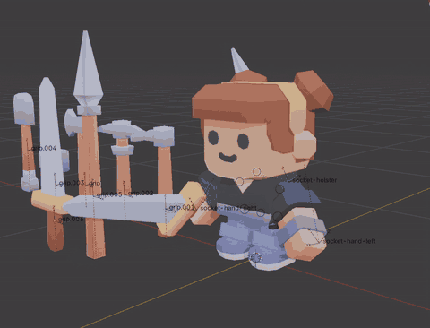

# Gamepad Navigation in Blender

Navigate Blender's 3D viewport with a gamepad (PlayStation, Xbox, Switch, etc) with no extra drivers or separate special software.



## Install

1. Download the `.zip` from the [releases](https://github.com/starfrogdev/blender-gamepad-nav/releases).
2. In Blender open **Edit > Preferences > Get Extensions > V (top right) > Install from Disk…** and pick the zip.

NOTE: This add-on requires SDL3 (which appears to be shipped in Blender 5.2).

## Controls

| Input | Does |
| --- | --- |
| Left stick | moves forward / back and strafes left / right |
| Right stick | looks around |
| Bumpers | moves the camera up and down |
| Right trigger | increases the speed of the camera |
| Left trigger | reduces the speed of the camera |
| Face Button North (Triangle / Y) | toggles perspective / orthographic (default mapping) |

NOTE: In an **orthographic** view the left stick's forward and back **zoom** because a flat view shows no forward motion. Strafing and moving up and down pan the view.

The gamepad moves **the camera** instead of the view when the viewport looks through the scene camera (numpad `0`). It drives the largest 3D viewport in Blender's main window.

### Customizing button mappings

Each button runs a ready-made action or a **Custom operator…** that you type. A custom operator takes keyword arguments such as `view3d.view_axis(type='TOP')` or `screen.frame_jump(end=False)`. Blender's keybindings run the same operators. Any operator you can bind to a key works here.

## Build from source

```bash
mkdir dist
blender --command extension build --output-dir dist
```

This makes the installable zip in `dist/`. The extension is plain Python with no dependencies to fetch. It binds SDL3 with `ctypes` in `sdl.py`.

## Licence

GPL-3.0-or-later (see `LICENSE`).
